## 💫 Salut 👋, moi c'est **Anthonin Chesneau**

🎓 Étudiant en **BTS SIO + Bachelor Informatique** à l'**EPSI Bordeaux**

- 🔭 *Je travaille actuellement sur :* **Studex**
- 🌱 *J'approfondis :* ma compréhension du code et le développement front-end et back-end
- 🏉 *Fun fact :* je combine code et rugby

## 💻 Tech Stack :

 

## 🌐 Réseaux :

<!-- Remplace les "#" par tes vrais liens -->

## 🚀 Projets

## 🎯 Ce sur quoi je me concentre

`Vue.js` · `TypeScript` · `PHP` · `Python` · `FastAPI` · `Docker` · `Linux` · `Front-end` · `Back-end`

## 📊 Statistiques GitHub :

## 🧱 Mes contributions

