# Salut, moi c'est Anthonin 👋

## 👤 À propos

- 🎓 Bachelor **Systèmes Informatiques et Numériques** à l'EPSI Bordeaux, en parallèle d'un BTS SIO 2ᵉ année
- 🧑‍🤝‍🧑 Délégué de classe : je remonte les questions des élèves et diffuse les notes
- 🎤 Ambassadeur de l'école depuis 2025 (salons, journées portes ouvertes)
- 🎯 Objectif carrière : rejoindre l'**Union Bordeaux Bègles (UBB)** en combinant IT et rugby
- 🔭 Je recherche un **stage informatique pour janvier-février 2027** (Bordeaux ou Paris)
- 💬 Demandez-moi tout sur le LAMP stack, WordPress, Vue.js/TypeScript, FastAPI, Docker ou Linux

## 🛠️ Stack technique

## 📊 Statistiques GitHub

## 🏆 Trophées

## 🎮 Mes contributions, version arcade

Six façons de regarder le même graphe. Généré chaque nuit par <a href="./scripts/arcade.py"><code>scripts/arcade.py</code></a>.

### 🧱 Tetris

### 🐍 Snake

### 👻 Pac-Man

### 🏓 Casse-briques

### 🚀 Space Shooter

### 🏙️ Vue 3D

---

⭐ Si ce profil vous a donné une idée, n'hésitez pas à y jeter un œil régulièrement !

