<div align="center">


<br/>


</div>

<br/>

## 👤 À propos de moi

```yaml
anthonin:
  études: "Bachelor SIN + BTS SIO (double cursus) — EPSI Bordeaux"
  rôles: ["Délégué de classe", "Ambassadeur de l'école depuis 2025"]
  recherche: "Stage informatique, janvier-février 2027, Bordeaux/Paris"
  objectif: "Rejoindre l'IT de l'Union Bordeaux Bègles (rugby + tech)"
  stack: [LAMP, WordPress, "Vue.js/TypeScript", FastAPI, Docker, Linux, Java]
```

- 🔭 Travaille actuellement sur **Studex**, **CodeQuest** et un **dashboard perso en Flutter**
- 🌱 Approfondit Vue.js/TypeScript et l'administration de bases SQL Server
- 👯 Ouvert à toute collaboration sur un projet web ou un projet lié au rugby/sport-tech
- 🤔 Recherche un **stage informatique pour janvier-février 2027**
- 💬 Discutons LAMP, WordPress, Vue.js/TypeScript, FastAPI, Docker ou Linux
- ⚡ Fun fact : je combine code et rugby, avec l'UBB en ligne de mire

<div align="center">

<!-- 🔗 Remplace ces liens par les tiens si tu veux les activer -->
<a href="#"></a>
<a href="#"></a>
<a href="#"></a>

</div>

## 🛠️ Stack technique

<div align="center">

**Langages & Frameworks**
<br/>


<br/><br/>

**Outils & Infrastructure**
<br/>


</div>

## 📊 Statistiques GitHub

<div align="center">


</div>

<div align="center">


</div>

## 🏆 Trophées

<div align="center">


</div>

## 📌 Quelques projets

<div align="center">

<a href="https://github.com/anthonin-tech/CodeQuest"></a>
<a href="https://github.com/anthonin-tech/Notely"></a>
<a href="https://github.com/anthonin-tech/veille-bot"></a>

</div>

## 💬 Citation du jour

<div align="center">


</div>

## 🎮 Mes contributions, version arcade

<div align="center">
<sub>Sept façons de regarder le même graphe de contributions. Tout est généré chaque nuit par <a href="./scripts/arcade.py"><code>scripts/arcade.py</code></a> et <a href="./scripts/tetris.py"><code>scripts/tetris.py</code></a> — aucun service tiers n'a accès au repo.</sub>
</div>

### 🧱 Tetris
<p align="center"></p>

### 🐍 Snake
<p align="center"></p>

### 👻 Pac-Man
<p align="center"></p>

### 🏓 Casse-briques
<p align="center"></p>

### 🚀 Space Shooter
<p align="center"></p>

### 🏙️ Vue 3D
<p align="center"></p>

### 🧬 Jeu de la vie (Conway)
<p align="center"></p>
<p align="center"><sub>Les cases actives forment la génération 0 ; les règles classiques de Conway font évoluer la population ensuite.</sub></p>

## 🧩 Autres possibilités (non activées ici)

<details>
<summary>Cliquer pour voir ce qu'il est possible d'ajouter en plus</summary>

<br/>

Ces extras existent dans l'écosystème des profils GitHub mais demandent soit un compte externe, soit de donner un accès en écriture au repo à un outil tiers — je ne les ai donc pas activés par défaut. Voici ce qu'ils font :

| Extra | Ce que ça ajoute | Ce qu'il faut |
|---|---|---|
| **WakaTime** | Temps de code par langage, heures de la journée | Un compte WakaTime + extension dans ton éditeur |
| **Spotify Now Playing** | Le morceau que tu écoutes en direct | Une appli Spotify (OAuth) + une Action GitHub avec tes clés |
| **Blog posts (RSS)** | Tes derniers articles de blog affichés automatiquement | Un blog avec un flux RSS |
| **Discord Presence** | Ton statut Discord en direct | Un bot Discord à héberger |
| **Métriques avancées (lowlighter/metrics)** | Dizaines de graphiques (langages, habitudes, PR, issues…) en une image | Une Action GitHub tierce avec accès en écriture |
| **Repos épinglés natifs** | 6 cartes de dépôts en haut de ton profil | Se fait dans GitHub, pas dans ce README : « Customize your pins » sur ta page de profil |

Si l'un de ces extras t'intéresse, dis-le-moi : je peux préparer le bloc markdown prêt à coller, ou te guider pour la configuration du compte externe nécessaire.

</details>

<div align="center">

---

<sub>⭐ Si ce profil vous a donné une idée, n'hésitez pas à y jeter un œil régulièrement !</sub>


</div>
