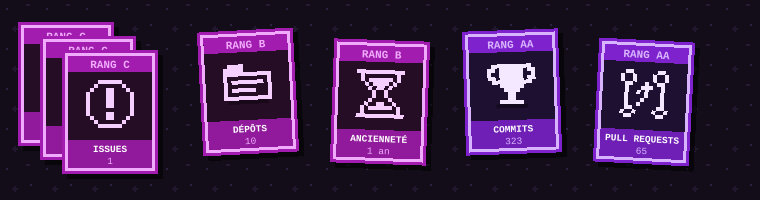
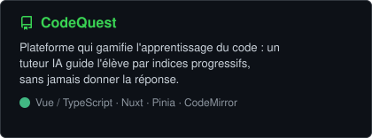
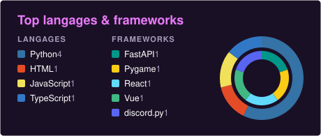

## À propos de moi

<table>
<tr>
<td width="38%" align="center">

</td>
<td>

### 🎓 Étudiant en **BTS SIO + Bachelor Informatique** à l'**EPSI Bordeaux**

### 🔭 Je travaille actuellement sur **Studex**

### 🌱 J'approfondis ma compréhension du code et le développement front-end et back-end

### 🏉 Je combine code et rugby

</td>
</tr>
</table>

## Tech Stack :

 

## Réseaux :

<!-- Remplace les "#" par tes vrais liens -->

## Trophées GitHub

## Projets

## Statistiques GitHub :

## Mes contributions

